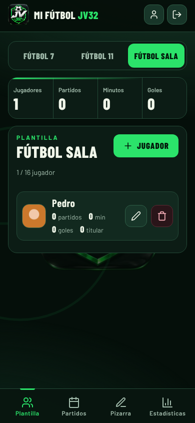
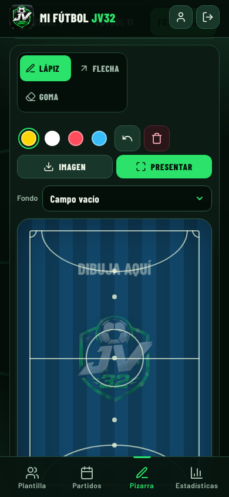
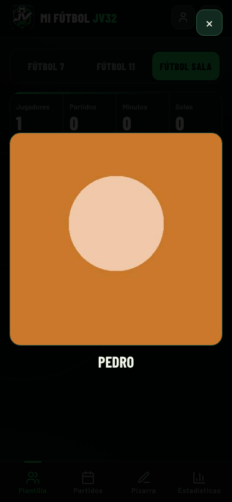

<div align="center">

# Mi Fútbol JV32

**Tu equipo bajo control:** plantilla, alineaciones, pizarra táctica, partidos y estadísticas, desde el móvil.

🌐 **[app.monetizaplus.com](https://app.monetizaplus.com)**

</div>

<p align="center">
  
  
  
</p>

## Qué hace

- **Plantilla** por modalidad (Fútbol 11, Fútbol 7 y Fútbol sala), con foto del jugador que se puede ampliar.
- **Partidos** con rival, fecha, minutos, goles y titulares.
- **Alineaciones** con formaciones, arrastrando a los jugadores al campo. Cada modalidad tiene su propio campo (el de fútbol sala es una pista con áreas semicirculares).
- **Pizarra táctica** para dibujar jugadas con lápiz y flechas, sobre un campo vacío o sobre una alineación.
- **Imágenes para compartir:** descarga la alineación o la pizarra como PNG listo para WhatsApp o redes.
- **Estadísticas** del equipo y de cada jugador (victorias, empates, derrotas, goles, minutos…).
- **Cuentas de usuario:** cada entrenador ve solo sus datos. Puede descargarlos o borrar su cuenta desde «Mi cuenta».
- **Se instala como app** en el móvil y **abre sin conexión**.

## Planes

| | Gratis | Pro (5,99 €/mes, IVA incluido) |
|---|---|---|
| Jugadores | Fútbol 11: 25 · Fútbol 7: 14 · Fútbol sala: 16 | Sin límite |
| Partidos | 5 por modalidad | Sin límite |

Los límites se aplican en la base de datos (no se pueden saltar desde la app).

## Cómo está hecho

Web estática, sin servidor propio ni proceso de compilación:

- HTML, CSS y JavaScript puro (PWA con *service worker*).
- [Supabase](https://supabase.com) para cuentas y base de datos, con seguridad por filas (RLS): cada usuario solo accede a lo suyo.
- Alojada en **GitHub Pages** con dominio propio y HTTPS.
- Sin dependencias externas en ejecución: la librería de Supabase y las letras están dentro del repositorio, y hay una política de seguridad de contenido (CSP) restrictiva.
- Captcha opcional con Cloudflare Turnstile.

```
index.html            Estructura de la página y política CSP
styles.css, logo.css  Estilos (el logo va aparte porque pesa)
app.js                Toda la lógica de la aplicación
config.js             Configuración y datos legales (ver abajo)
sw.js                 Modo sin conexión y actualizaciones
version.json          Versión actual (para el aviso «hay una versión nueva»)
supabase.js, *.woff2  Librería de Supabase y tipografías (Barlow) en local
manifest.webmanifest  Instalación como app + iconos
supabase-multiusuario.sql   Tablas, seguridad y límites de la base de datos
doc-*.png             Capturas de este README
```

## Puesta en marcha (para tu propia copia)

1. Crea un proyecto en [Supabase](https://supabase.com).
2. En **SQL Editor**, ejecuta `supabase-multiusuario.sql` (se puede repetir sin riesgo). Las tablas `futbol_personal_jugadores` y `futbol_personal_partidos` deben existir antes.
3. En **Authentication → URL Configuration**, pon la dirección de tu web como *Site URL* y en *Redirect URLs*.
4. Crea `config.js` junto a `index.html`:

   ```js
   window.APP_CONFIG = {
     supabaseUrl: 'https://TU-PROYECTO.supabase.co',
     supabaseAnonKey: 'TU_CLAVE_PUBLICA_ANON',
     legalNombre: 'Tu nombre o razón social',
     legalNif: 'Tu NIF',
     legalDir: 'Tu dirección',
     contactEmail: 'tu@email.com',
     proUrl: '',              // enlace de pago del plan Pro (opcional)
     turnstileSiteKey: ''     // clave pública de Cloudflare Turnstile (opcional)
   };
   ```

   La clave *anon* es pública por diseño; la seguridad la dan las reglas RLS del SQL. **Nunca pongas aquí la clave `service_role`.**
5. Sube todo a un repositorio de GitHub y activa **Settings → Pages** (rama `main`, carpeta raíz).

Para probarlo en local: `python3 -m http.server 8000` y abre `http://localhost:8000`.

## Publicar una nueva versión

Cambia el número en tres sitios: `<meta name="app-version">` de `index.html`, `version.json` y `VERSION` en `sw.js` (y los `?v=` de `index.html`). Los usuarios verán el aviso «Hay una versión nueva» y se actualizarán con un toque.

## Privacidad y legal

La app incluye términos de uso y política de privacidad (RGPD), se aceptan al crear la cuenta y quedan registrados con su versión. No usa publicidad ni analítica. Los textos son una base razonable pero conviene revisarlos con un profesional antes de cobrar.

## Licencia

© Francisco Javier Casado García. Todos los derechos reservados. Este repositorio es público para alojar la web; no se concede permiso para copiar, modificar ni redistribuir el código sin autorización.
